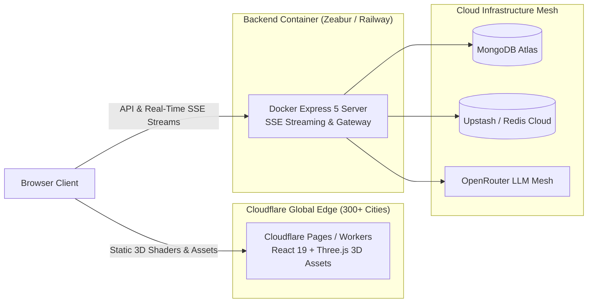

# 🚀 Modern Cloud Deployment Guide: Cloudflare Pages + Zeabur / Railway (Docker)

This guide walks you through deploying **Thunder AI** using a modern, fast, decoupled cloud architecture:
* 🌐 **Frontend**: **Cloudflare Pages / Workers** (100% Free, 0ms Cold Start, Global Edge CDN for Three.js 3D assets).
* ⚡ **Backend**: **Zeabur** or **Railway** (Runs your production [`Dockerfile`](./Dockerfile), **Fast, No 60-Second Sleep**, Native SSE Streaming).

---

## 🏗️ Architecture Overview



---

## 🛠️ Step 1: Deploy Backend to Zeabur (Recommended — Free & No Credit Card)

**Zeabur** (`zeabur.com`) is the fastest, easiest replacement for Koyeb/Render:

1. Go to **[zeabur.com](https://zeabur.com)** and log in with your **GitHub** account.
2. Click **Create Project** (choose region closest to you, e.g., Asia East or US West).
3. Click **Deploy New Service** > **Deploy from Source Code** > select **`chandan0000001/ThunderAI`**.
4. Zeabur automatically detects your root **`Dockerfile`**.
5. In the service settings, go to the **Variables** tab and add your environment variables:
   ```env
   NODE_ENV=production
   PORT=3000
   MONGO_URI=your_mongodb_atlas_connection_string
   JWT_SECRET=your_jwt_secret_key
   OPENROUTER_API_KEY=your_openrouter_api_key
   DEFAULT_AI_MODEL=openrouter/free
   REDIS_URL=your_redis_connection_url
   TOKEN_LIMIT=10000
   TOKEN_WINDOW_SECONDS=18000
   EMAIL_USER=your_email@gmail.com
   EMAIL_PASS=your_email_app_password
   FRONTEND_URL=https://thunderai.pages.dev
   ```
6. In the **Networking** tab:
   * Click **Generate Domain**.
   * Zeabur will generate a free public HTTPS domain like:
     `https://thunder-ai.zeabur.app`
7. Test your backend by visiting: `https://thunder-ai.zeabur.app/health`.
   It will return:
   ```json
   {"status":"healthy","timestamp":"2026-11-04T..."}
   ```

*(Alternative: You can also use **[Railway](https://railway.com)** — click "New Project" > "Deploy from GitHub repo", add environment variables, and click "Generate Domain" under Networking).*

---

## 🌐 Step 2: Deploy Frontend to Cloudflare Pages

1. Log in to your **[Cloudflare Dashboard](https://dash.cloudflare.com/)**.
2. Go to **Workers & Pages** > **Create application** > **Pages** > **Connect to Git**.
3. Select repository: **`chandan0000001/ThunderAI`** and branch: **`main`**.
4. Configure Build settings:
   * **Framework preset**: `Vite`
   * **Root directory**: `Frontend`
   * **Build command**: `npm run build`
   * **Build output directory**: `dist`
5. Under **Environment variables (Advanced)**, add:
   ```env
   VITE_API_BASE_URL=https://thunder-ai.zeabur.app
   ```
   *(Paste your actual backend domain from Step 1).*
6. Click **Save and Deploy**.
7. Cloudflare will deploy your site in ~30 seconds, giving you your public URL like:
   `https://thunder-ai.pages.dev`

*(Optional CLI Deployment)*:
You can also deploy directly from your local terminal using Cloudflare's Wrangler CLI:
```bash
cd Frontend
npm run deploy
```

---

## 🔄 Step 3: Link the Domains

1. Go back to your **Zeabur** dashboard > your service > **Variables**.
2. Update `FRONTEND_URL` to match your Cloudflare domain:
   ```env
   FRONTEND_URL=https://thunder-ai.pages.dev
   ```
3. Zeabur will automatically restart in seconds with the updated CORS policy.

---

## ✨ Why this setup is superior to Render:

| Feature | Render (Free Tier) | Cloudflare Pages + Zeabur (Docker) |
| :--- | :--- | :--- |
| **Cold Starts** | 🐢 60–90 seconds sleep | ⚡ **0ms for Frontend; snappy backend with no long wakeups** |
| **3D Three.js Performance** | Loaded from single origin container | ⚡ **Cached on 300+ global Cloudflare edge locations** |
| **SSE Streaming** | Occasional proxy buffering | ⚡ **Native HTTP/2 streaming pipeline** |
| **Portability** | Locked to Render configuration | 🐳 **Containerized Dockerfile runs anywhere (Zeabur, Railway, Fly, VPS)** |
| **Bandwidth** | 100 GB cap | ⚡ **Unlimited free static bandwidth on Cloudflare** |
