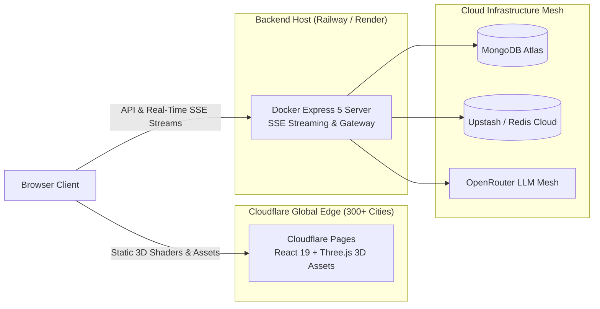

# Cloud Deployment Guide: Cloudflare Pages + Backend

This guide walks you through deploying **Thunder AI** using a decoupled cloud architecture:
* **Frontend**: **Cloudflare Pages / Workers** (100% Free, 0ms Cold Start, Global Edge CDN for Three.js 3D assets).
* **Backend**: **Railway** or **Render (Lightweight Backend-Only)** (Runs your production [`Dockerfile`](./Dockerfile) with fast builds and native SSE streaming).

---

## Architecture Overview



---

## Step 1: Deploy Frontend to Cloudflare Pages

### In your Cloudflare Dashboard:
1. Log in to **[dash.cloudflare.com](https://dash.cloudflare.com/)**.
2. Click on **Workers & Pages** in the left sidebar.
3. Click **Create application** > Select the **Pages** tab (not Worker).
4. Click **Connect to Git** > select your **GitHub account** under `Git account` (if not connected, click `Add account`).
5. Select the repository: **`chandan0000001/ThunderAI`** and branch: **`main`**.
6. Set the build configuration:
   * **Framework preset**: `Vite`
   * **Root directory**: `Frontend`
   * **Build command**: `npm run build`
   * **Build output directory**: `dist`
7. Under **Environment variables (Advanced)**, add:
   ```env
   VITE_API_BASE_URL=https://your-backend-url.up.railway.app
   ```
   *(Paste your actual backend domain from Step 2).*
8. Click **Save and Deploy**. Cloudflare gives you an instant global URL:
   `https://thunder-ai.pages.dev`

*(Note: The root `wrangler.toml` and `wrangler.jsonc` in the repository ensure Cloudflare automatically detects the project configuration).*

---

## Step 2: Deploy Backend (Choose Option A or Option B)

### Option A: [Railway](https://railway.com) (Recommended — Free Trial, Fast Docker)
1. Go to **[railway.com](https://railway.com)** and log in with **GitHub**.
2. Click **New Project** > **Deploy from GitHub repo** > select `chandan0000001/ThunderAI`.
3. Railway automatically detects the root [`Dockerfile`](./Dockerfile).
4. Go to the **Variables** tab and add your environment variables:
   ```env
   NODE_ENV=production
   PORT=3000
   MONGO_URI=your_mongodb_atlas_connection_string
   JWT_SECRET=your_jwt_secret_key_minimum_32_characters
   BYOK_ENCRYPTION_KEY=your_64_character_hex_encryption_key
   ACCESS_TOKEN_TTL=15m
   REFRESH_TOKEN_TTL_SECONDS=604800
   OPENROUTER_API_KEY=your_openrouter_api_key
   OPENROUTER_SEARCH_MODEL=google/gemini-2.0-flash-exp:free
   TAVILY_API_KEY=your_tavily_api_key_optional
   SERPER_API_KEY=your_serper_api_key_optional
   DEFAULT_AI_MODEL=openrouter/free
   REDIS_URL=your_redis_connection_url # MANDATORY: Production fails closed if absent
   TOKEN_LIMIT=10000
   TOKEN_WINDOW_SECONDS=18000
   BCRYPT_SALT_ROUNDS=12
   EMAIL_USER=your_email@gmail.com
   EMAIL_PASS=your_email_app_password
   FRONTEND_URL=https://thunder-ai.pages.dev
   CORS_ALLOWED_ORIGINS=https://thunder-ai.pages.dev
   ```

   > [!IMPORTANT]
   > **Security Baseline & Fail-Closed Invariants (Audit Remediation v4)**:
   > - `JWT_SECRET` must be at least 32 characters long, high-entropy, and non-trivial (startup validates and fails fast if insecure).
   > - `ACCESS_TOKEN_TTL` must be bounded between `60s` and `3600s` (e.g., `15m`).
   > - `REFRESH_TOKEN_TTL_SECONDS` must be bounded between `3600` and `2592000` (e.g., `604800` for 7 days).
   > - `REDIS_URL` is strictly mandatory in production mode (`NODE_ENV=production`); the server rejects localhost fallbacks and refuses to start if missing.
   > - Refresh token rotation enforces an Absolute Family Lifetime Policy capped at the remaining family TTL to eliminate session immortality.
   > - Administrator accounts are provisioned via explicit operator CLI tooling, not through ambient runtime environment variables or login master-password bypasses. Once deployed, run the audited seeding task in Railway's shell or one-off runner:
   > ```bash
   > ADMIN_EMAIL=admin@thunderai.com ADMIN_PASSWORD="your_strong_admin_password" npm run seed:admin
   > ```
5. In the **Settings** or **Networking** tab, click **Generate Domain** (gives you `https://thunder-ai-production.up.railway.app`).
6. Test your backend: `https://thunder-ai-production.up.railway.app/health`.

---

### Option B: Render as a Pure Backend (NO Heavy Frontend Build!)
Render only felt slow before because it was trying to compile the entire 3D React frontend on a 512MB RAM container. When running **only the backend**, it starts in **3 seconds** and uses only **50MB RAM**!

1. Go to **[dashboard.render.com](https://dashboard.render.com)** > **New +** > **Web Service**.
2. Connect `chandan0000001/ThunderAI`.
3. Configure settings:
   * **Root Directory**: `Backend` *(Important: this ensures it only builds the backend!)*
   * **Environment**: `Node`
   * **Build Command**: `npm install --omit=dev` *(Takes 5 seconds!)*
   * **Start Command**: `npm start`
   * **Plan**: `Free`
   * **Health Check Path**: `/health`
4. Add your **Environment Variables** (`MONGO_URI`, `OPENROUTER_API_KEY`, `REDIS_URL`, `JWT_SECRET`, etc.).
5. Click **Create Web Service**.
6. **To prevent Render from ever sleeping (Zero Cold Starts)**:
   * Sign up for free at **[cron-job.org](https://cron-job.org)** or **[uptimerobot.com](https://uptimerobot.com)**.
   * Create a free HTTP ping to `https://your-backend.onrender.com/health` every **10 minutes**.
   * Render will **stay awake 24/7 with 0s cold starts**, completely free!

---

## Step 3: Connect Frontend and Backend

1. In your **Backend** environment variables (on Railway or Render), set:
   ```env
   FRONTEND_URL=https://thunder-ai.pages.dev
   ```
2. In your **Cloudflare Pages** environment variables, set:
   ```env
   VITE_API_BASE_URL=https://your-backend-url.up.railway.app
   ```
3. Your full-stack platform is live, lightning fast, and completely free!
